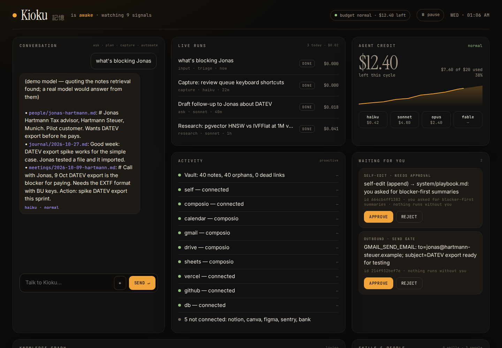
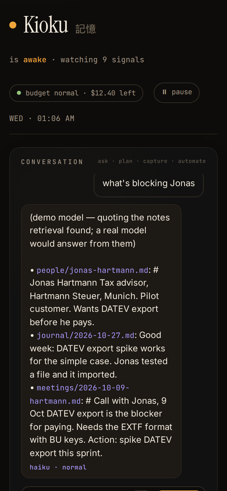

# Kioku (記憶)

**A private, self-hosted agentic personal assistant — a cloud brain with local hands.**
*Kioku* (記憶, "memory") is a second brain that never sleeps: it owns a markdown knowledge
vault, reasons over it with the Claude Agent SDK, works autonomously under a strict budget and
approval model, and reaches you through Telegram, a web command center, or an API.

[](LICENSE)


[](https://github.com/Kage7047/kioku-assistant/actions/workflows/ci.yml)
[](https://github.com/Kage7047/kioku-assistant/actions/workflows/ci.yml)



> This is a portfolio/reference implementation of a single-user assistant. The design,
> architecture, and full build log live in [`docs/`](docs/INDEX.md). The owner's private
> knowledge vault is **not** part of this repository — the code runs against your own.

---

## Why it's interesting

Most "AI assistant" projects are a thin wrapper around a chat endpoint. Kioku is the opposite:
a small but complete **agentic system** engineered around three hard constraints — *cost*,
*trust*, and *durable memory*.

- **Files are truth, the database is an index.** All knowledge is plain markdown in a
  git-backed vault. Postgres + pgvector is a rebuildable cache — drop it and lose nothing.
- **It runs on a subscription, not a metered API.** The whole cost architecture (Haiku
  triage → Sonnet work → Opus orchestration, prompt-cache-friendly prefixes, deterministic
  Python for anything that doesn't need a model, and a hard budget guard on every run) is
  designed to keep a genuinely useful always-on assistant inside a personal plan's monthly
  agent credit.
- **Autonomy with a human gate.** It works end-to-end up to any irreversible or outbound
  action — sending a message, spending money, deleting outside the vault — which it *stages*
  for one-tap approval instead of executing.
- **It learns you over time.** A derived model of your rhythms shapes when and how it nudges;
  a weekly pass proposes (never silently writes) sharpened facts about your world.

## Architecture

```
                Telegram ─┐
              Web SPA ────┤        ┌─────────────┐     ┌──────────────────────┐
                  CLI ────┼──▶ FastAPI  ──▶  Celery ──▶ Claude Agent SDK      │
                  API ────┘   (gateway)   (worker+beat)  (routing · caps ·    │
                                  │            │          tools · sub-agents) │
                                  │            │         └──────────┬─────────┘
                             Redis (queue + SSE pub/sub)            │
                                  │                                 ▼
                        Postgres + pgvector           Markdown vault (git) = source of truth
                        (BM25 + vector index)          Langfuse (token/cost tracing)
```

**Retrieval** is a hybrid of BM25 (lexical, read live from disk) and pgvector (semantic,
cross-lingual), fused with reciprocal-rank fusion. **Memory** is layered: raw notes → a digest
loop that tags and links them → a claim ledger of durable, checkable facts with staleness and
contradiction detection → a people CRM.

## Features

**Interfaces**
- Telegram bot (primary), a self-contained web **command center** (chat, live run streaming
  over SSE, approval inbox, budget + connector health), a CLI, and a token-auth HTTP API.

**The brain**
- Claude Agent SDK orchestrator with **difficulty-based model routing** and an **intent
  router** that narrows the toolset (and mounts external connectors) per request.
- **Budget guard:** every run gets a pre-flight worst-case cost estimate → allow / downgrade /
  refuse, with graceful global degradation (normal → conserve → haiku-only → halt).
- Bounded sub-agent fan-out for large parallel jobs, capped in aggregate.

**Memory**
- Git-backed markdown vault with incremental (mtime + hash) indexing; hybrid BM25 + pgvector
  retrieval; a self-maintaining claim ledger; a people CRM populated from the digest.

**Autonomy (the three loops + agency)**
- Capture → digest → connect loops that organize the vault over time.
- Scheduled work via Celery beat: morning brief, evening wind-down, watches, proactive
  proposals, an opportunity radar, and a weekly self-learning pass.
- **Approval gate** for every outbound/irreversible action.
- **Self-improvement loop:** proposes tweaks to its own playbook, staged for approval.
- **Interrupt governor:** proactive nudges are quiet by default and earn the right to
  interrupt; per-class daily budgets and mute/unmute.
- **Project charters:** hand it a bounded goal with guardrails and an autonomy level.
- **Claude Code hand-off:** dispatches heavy local coding to a runner on your own machine
  (a separate interactive pool), plus a hardest-gated **computer-use** scaffold for browser tasks.

**Observability & ops**
- Langfuse tracing (tokens + cost per run); Docker Compose for local, Railway for managed deploy.

## Tech stack

Python 3.12 · Claude Agent SDK · FastAPI + SSE · Celery + Redis · Postgres + pgvector ·
python-telegram-bot · rank-bm25 · Langfuse · Docker · Railway.

## Repo layout

```
docs/                 design docs and build phases (start at docs/INDEX.md)
  adr/                architecture decision records — the why behind the main choices
  security/           threat model
mockups/              command-center UI mockups (desktop + mobile)
runner/               local hand-off runner (runs approved coding tasks on your own machine)
src/kioku/
  config.py           env-driven settings
  api/                FastAPI gateway, SSE relay, static command-center SPA
  agent/
    orchestrator.py   run_agent: one capped, budget-checked, gated session
    prompts.py        persona prefix, live config, retrieved context (fenced as data)
    toolsets.py       tool surface per intent, turn caps
    gate.py           the permission callbacks (outbound approval, approved-call scoping)
    usage.py          token and cost accounting off the SDK stream
    router.py         intent, difficulty and verbosity
    tools/            vault, calendar, scheduler, watches, hand-off
  memory/             schema.sql · vault (fs + BM25) · index/retrieval (pgvector) · budget · approvals · claims
  worker/tasks/       Celery tasks by concern: chat, vault_ops, rhythms, agency, awareness, actions
  frontdoor/          Telegram bot + formatting
tests/                unit (scripted model, no network) and integration (Postgres + Redis)
```

Why it is built this way: [`docs/adr/`](docs/adr/README.md).

## Try it in one command

```bash
make demo     # Docker only — no API key: a stub model quotes the fictional sample vault
# open http://localhost:8000, token: demo
```

Everything except the model is real: API, worker, Postgres + pgvector, Redis, routing, retrieval,
the budget guard and the outbound gate. Details in [`docs/DEMO.md`](docs/DEMO.md).

## Running it

Requires Docker. Kioku authenticates against a Claude subscription's agent credit via an OAuth
token (`claude setup-token`) — **do not** set `ANTHROPIC_API_KEY`, which would silently bill
pay-as-you-go instead.

```bash
cp .env.example .env     # set the auth token, TELEGRAM_*, VAULT_PATH, and (optionally) LANGFUSE_*
docker compose up --build
# then message your Telegram bot, e.g.:  /audit
```

Point `VAULT_PATH` at any folder of markdown; the first `/audit` run has Kioku inspect and
report on your vault as its first real job. Every knob is environment-driven — the full list is
in [`docs/reference/configuration.md`](docs/reference/configuration.md). Full first-start
walkthrough: [`docs/QUICKSTART.md`](docs/QUICKSTART.md). Managed deploy (Railway services +
pgvector + Redis + a git-backed vault): [`docs/05-deploy-railway.md`](docs/05-deploy-railway.md).

## Security

An agent that reads email and web pages *will* see injected instructions, so Kioku assumes the model
can be tricked and limits what a tricked model can do — in code, outside the model:

- **Outbound gate.** Every external action is default-deny: reads and drafts run, anything that sends,
  shares, deletes, invites or drives a browser is staged for one-tap approval. The gate fails closed.
- **Scoped approvals.** An approved action runs with exactly the approved tool and arguments, once.
- **Protected vault zones.** `.git/` is never writable and the `system/` config spine changes only via
  an approved edit — checked on resolved paths, so `..` and symlinks don't get around it.
- **Fail-closed API.** Constant-time token check; with no token set, the API accepts only its own in-process bot.

The full threat model — eleven findings, their fixes, and the risks deliberately accepted — is in
[`docs/security/THREAT_MODEL.md`](docs/security/THREAT_MODEL.md); each control has a regression test in
[`tests/unit/test_security.py`](tests/unit/test_security.py). Report issues privately: [`SECURITY.md`](SECURITY.md).

## Retrieval, measured

| | recall@5 | recall@1 | MRR@10 |
|---|---|---|---|
| BM25 only (embeddings off) | 0.75 | 0.68 | 0.71 |
| vector only | 0.97 | 0.82 | 0.89 |
| **hybrid (shipped)** | **0.97** | **0.85** | **0.90** |

40 labelled queries (exact IDs, paraphrase, cross-lingual, vague) over a fictional sample vault,
run against the production retrieval code. The first run showed the original fusion *losing* to
vector search alone (0.82); the fix and the method are in [`eval/`](eval/README.md).

## Testing

```bash
pip install -e ".[dev]"
docker compose -f docker-compose.test.yml up -d --wait   # Postgres + pgvector, Redis
pytest --cov
```

- **Unit tests** run with no network: fakeredis, a temporary vault, and a scripted stand-in for
  the Agent SDK's message stream ([`tests/fakes.py`](tests/fakes.py)). That makes whole agent runs
  testable — budget pre-flight, tool narrowing, the outbound gate, streaming, token accounting, and
  every failure path (timeouts, turn caps, usage limits, crashes) — deterministically and for free.
- **Integration tests** run against real Postgres + pgvector and Redis: the run ledger and
  month-to-date spend that feed the budget guard, stale-run reaping, incremental re-indexing, and the
  full hybrid retrieval path (HNSW cosine search fused with BM25).
- CI runs both on every push and pull request; a skipped integration test fails the build.

More in [`tests/README.md`](tests/README.md).

## Command center

A Vite + React app ([`web/`](web/README.md)) built into the API's static folder and served
same-origin — chat with live streaming, runs, agent credit, the approval inbox, activity, a living
knowledge graph of the vault, skills and people. GSAP drives the motion, Lenis the scrolling,
React Bits supplies the cards and micro-interactions; it respects reduce-motion and works on a phone.

<p align="center"></p>

## Design principles

- **Files are truth.** Knowledge is markdown on disk; the database is a rebuildable index.
- **Cap every run.** Max turns, token cap, timeout — no uncapped loops.
- **Route models by difficulty.** Cheap triage, capable work, expensive orchestration only when earned.
- **Cache the prefix.** A stable persona + tool prefix keeps prompt-cache hits high.
- **Allow-list capabilities.** No silent deletes; money / messages / bookings hit a human gate.
- **Adopt before build.** One custom UI; everything else leans on existing tools (Langfuse, Obsidian).

## Project status & roadmap

A working personal system, built in documented phases (see [`docs/`](docs/INDEX.md)):

- **P0** capped agent + Telegram + vault audit · **P1** episodic memory, awareness pollers, web research
- **P2** command center, sub-agent fan-out, local runners · **P3** scheduled autonomous runs + hand-off
- **P4** model-of-you, self-improvement, interrupt governor, dev-task runner, project ownership, computer-use

Because it drives real tools, it's built defensively: pin `claude-agent-sdk` and verify the
`query()` / `ClaudeAgentOptions` / `@tool` signatures against your installed version, and
confirm current model IDs — the SDK surface moves.

## License

[MIT](LICENSE) © Ilya Nesterenok
